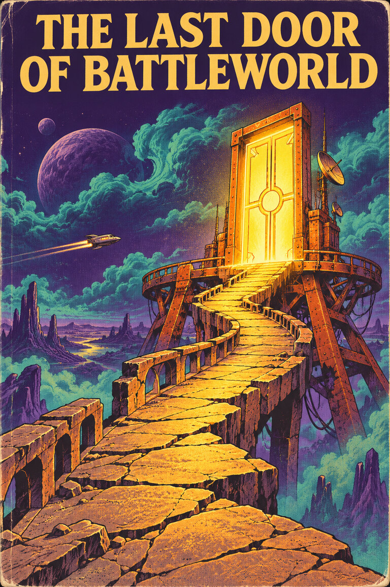

# The Last Door of Battleworld / Последняя дверь Мира битв

An original, unofficial fan adventure for a family playtest. One person plays
the hero; the other can narrate, read characters aloud and discuss ideas. Play
as Spider-Man, Storm or Iron Man. Doctor Doom is the antagonist and Ms. Marvel
helps the evacuees. This is a complete **short solo adventure**, not a port
of the TSR campaign. No original module prose, maps, art or stat blocks are
bundled. See [what we did not carry over](../../shared/last-door-of-battleworld/LIMITS.md).



The English-titled cover is shared by both editions.

## Run from the repository / Как запустить

From the repository root with Lua 5.4:

```sh
# Русский, с вариантами действий
lua5.4 main.lua --companion books.ru.last-door-of-battleworld.last-door-of-battleworld

# English, with numbered prompts
lua5.4 main.lua --companion books.en.last-door-of-battleworld.last-door-of-battleworld
```

Use `--text` instead of `--companion` for only typed commands. To try a
typed command, start with `look` / «осмотреться» or `examine` /
«осмотреть» and the item. Choose a named hero before the first scene.
`STATUS` / «СТАТУС» shows the live character values.

Для первой партии: ребёнок выбирает героя и говорит, что делать; взрослый
читает за Камалу и Дума. Можно исследовать сколько угодно: реального
таймера нет. Если бросок не вышел, игра не заканчивается и предлагает
другой способ. Не подсказывайте решение сразу: сначала спросите, что из
увиденного могло бы помочь.

This sample is for testing. It is deliberately not in the native
app catalog and is not part of an App Store build.

## Verify / Проверка

```sh
lua5.4 books/en/last-door-of-battleworld/test/test_walkthrough_battleworld.lua
```
